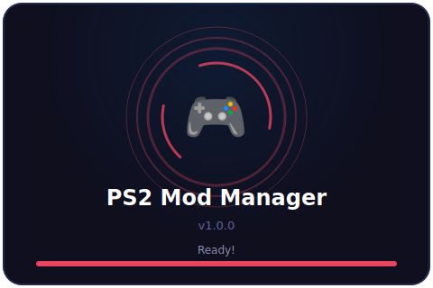
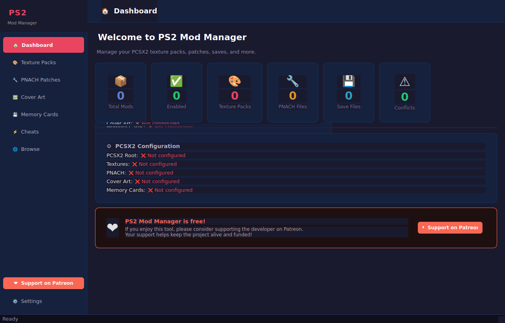
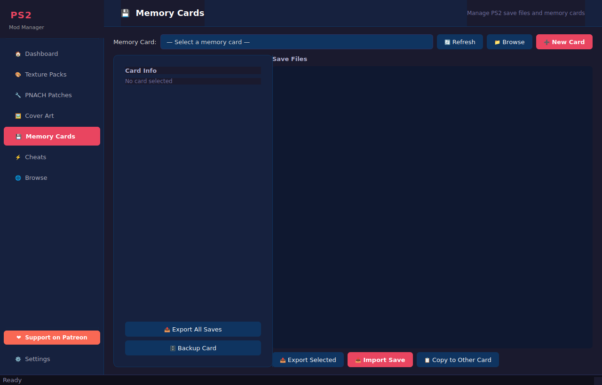
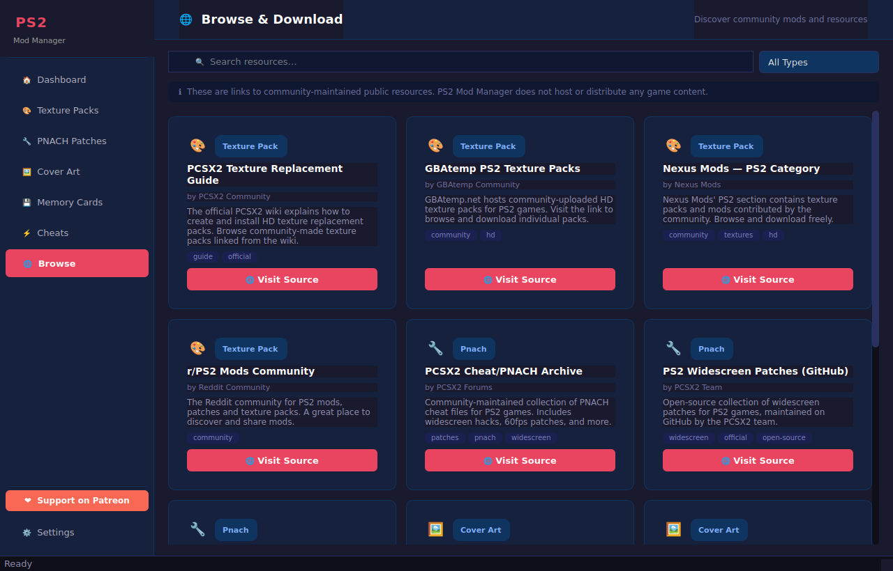

<p align="center">
  
</p>

<h1 align="center">PS2 Mod Manager</h1>

<p align="center">
  A modern, feature-rich desktop application for managing PCSX2 mods, texture packs,
  save files, PNACH patches, cover art, and cheats — all in one place.
</p>

<p align="center">
  <a href="https://www.patreon.com/c/DeadOnTheInside">
    
  </a>
  
  
  
</p>

---

## ✨ Features

### 🎨 Texture Pack Manager
- Import HD texture replacement packs (ZIP, 7z, folder)
- **Multi-part archive support** — packs split across `_Part1.zip`, `_Part2.zip` … (or 7-zip volumes) are extracted automatically; the import dialog detects all sibling parts and warns about any that are missing
- **Auto folder normalization** — packs that ship with a `replacement/` folder (common in Patreon releases) are automatically placed into the correct `textures/<SERIAL>/replacements/` layout when a Game ID is provided
- **Import readiness** — inline source, Game ID, and source-URL guidance enables Import only when ready; scrollable fields keep the action buttons visible on smaller screens
- Enable/disable individual packs without deleting them
- Set priority order — higher-priority packs win conflicts
- Greyed-out **"Completely Shadowed"** badge when a pack is 100% overridden by a higher-priority one
- One-click **Deploy** to push enabled packs to PCSX2
- **👤 See more by [author]** quick-filter button on every mod item
- **Cross-panel navigation** — "Find PNACH by this author" opens the PNACH panel pre-filtered
- **Remembered status filters** — show enabled/disabled mods, conflicts, completely shadowed texture packs, or code issues in enabled PNACH/cheat mods
- **Clearer mod rows** — status badges sit below the title, enabled state is written out, and conflict badges open review in one click
- Filtered lists show visible versus total counts and offer **Clear Filters** or **Import** directly in empty states

### 🔧 PNACH Patch Manager
- Manage `.pnach` game patches (widescreen, 60fps, gameplay tweaks)
- Enable/disable per-game patches independently
- **Automatic PNACH merging** — multiple enabled patches for the same game CRC are merged into one output file on deploy
- Address-level conflict detection between overlapping patch addresses

### 📋 Mod Profiles
- Save, search, duplicate, rename, and delete named enabled-mod setups from **Library → Profiles**
- Preview installed/missing mods and the enable/disable changes across the whole library before applying
- Applying batches deployment/undeployment once per affected mod type and reports warnings; reapplying retries file updates even when enabled flags already match, and priorities are unchanged
- Profiles never copy or remove live memory-card files; PNACH and cheats sharing a folder are merged together
- Existing profiles require overwrite confirmation, and failed saves leave saved profiles intact

### 🎮 Game Library Loading
- Disc-image folder checks, enumeration, and title/CRC lookups run in the background; installed-content auto-import still runs on the UI thread
- Same-folder scans retain previous disc results and selection while refreshing tracked-mod counts; changing folders clears old cards and details
- Loading and error feedback stays visible in either Library view; **Scan Library** retries failures, and **All Mods** remains usable independently
- Rapid scans/settings changes keep only one running scan and the latest queued request; stale results never replace the current folder
- **By Game** searches titles, serials, filenames, paths, regions, formats, and known CRCs; all words must match (across fields), ignoring case and punctuation
- Filter games with/without installed mods, disc images, or tracked-only games; sort by title, mod count, disc size, or serial, with shown/total counts
- Search/filter/sort preferences are remembered separately from **All Mods**. Filtering reuses existing cards without rescanning; hidden selections return when shown again, and **Clear Filters** recovers no-match results
- Toggles in **By Game** and **All Mods** now reconcile deployed files as well as saved flags. **Enable Game Mods / Disable Game Mods** preview only that game's changed flags, across content types, with default-No confirmation
- Library action results remain copyable across filters and view changes. Warnings/failures offer **Retry Original Action** for the original IDs and requested states, including already-saved flags; removed mods are skipped and later imports never join
- Retries use current Settings and require confirmation; a different action asks before replacing an earlier retry snapshot. **Dismiss Result** forgets the session's retry without undoing changes
- Affected destinations rebuild using all enabled mods, including other games and hidden results, to preserve priorities/shared files. Save-file toggles change library flags only and never copy or remove live memory cards

### ✏️ Mod Metadata
- Edit names, authors, versions, Game IDs, descriptions, source links, and tags from a mod row or **Details → Edit Metadata**
- Scrollable fields, inline validation, unsaved-change feedback, and **Revert Changes** keep editing manageable on smaller screens
- Metadata and explicitly fetched thumbnails save together; failures keep the draft open for retry, and Save never waits for a network request
- GameTDB thumbnail fetching runs in the background and discards results after a Game ID change, Revert, or dialog close

### 🔎 Installed-Mod Search
- Mod panels and **Library → View All Mods** share search across names, game titles/aliases, authors, descriptions, tags, files, paths, versions, and source links
- All words must match, even across different fields; use double quotes for a phrase, or `-demo` to exclude a term
- Narrow a field with `name:`, `author:`, `game:`, `serial:`, `tag:`, `file:`, `source:`, `path:`, `description:`, `version:`, `type:`, or `id:` — for example, `game:"GTA III" tag:hd -author:Demo`
- Searches ignore case and punctuation, compose with existing dropdown filters, and remain saved with the panel; **Clear Filters** recovers empty results
- Search changes only what is shown; **Enable All** and **Disable All** still affect every mod in their panel

### ✅ Scoped Batch Actions
- **Enable Shown / Disable Shown** change only matching results; **Enable All / Disable All** remain panel-wide, including hidden mods
- Button counts show how many enabled flags will change; confirmation previews the scope, destinations, and full mod list under **Show Details**
- Batches save flags once, clean disabled outputs, and reconcile each affected destination; PNACH/cheat types use their own configured folders or merge when they share one
- Warnings and failures retain **Retry Batch** for the original mod IDs, even when a status filter hides them after flags were saved; retries never include later imports
- Retry requires confirmation, skips removed/moved mods, and rechecks already-matching flags; a new confirmed batch replaces the previous retry snapshot
- Results are copyable; **Dismiss Result** forgets the session's retry snapshot without undoing changes. Save-file batches never copy or remove live memory cards

### 🖼️ Cover Art Manager
- Store and deploy cover art for PCSX2's game browser
- Cover art is automatically renamed to `{SERIAL}.png` (e.g. `SLUS-20062.png`) on deploy — the exact format PCSX2 expects
- **One cover art per game** — enabling a second cover for the same serial offers to auto-disable the other
- Download cover art from **GameTDB** (free, by game serial ID)
- Single and bulk cover downloads keep the dialog responsive, report per-game results, and offer **Stop After Current** / **Retry Remaining** without repeating successful bulk items
- Closing the cover dialog stops bulk scheduling after the current file; failed downloads leave existing covers intact. Library scans report missing/unreadable folders and can be retried

### ⚠️ Installed-Content Conflict Review
- **Resolve Conflicts** in Library or Browse scans configured PCSX2 folders in the background without freezing the dialog
- Search scan results by title, serial, CRC, description, or path; combine severity and auto-fixable filters, or **Clear Filters** to recover hidden results
- Selection survives filtering and re-scans; scrollable details, selected-file **Open Folder**, and **Copy Paths** speed up manual review
- Auto-Fix requires confirmation, affects only the selected result, and re-scans after success or failure; unavailable/error results cannot be fixed

### 🔀 Managed-Mod Conflict Review
- Content-panel conflict indicators open a searchable mod-pair comparison with shared-file/address filters and complete, copyable details
- A/B labels stay aligned with PNACH values; pair counts distinguish shared file references from address overlaps
- **Prioritize A/B** changes the whole mod's priority and re-deploys affected content; **Disable A/B** removes its deployed files and restores remaining enabled mods
- Higher priority wins copied-file collisions as well as merged PNACH addresses; priority choices affect other overlaps too, not just the selected pair
- Confirmations, deployment warnings, and retryable actions distinguish saved library state from installed files; live memory cards are never modified
- Use **Texture Picker** or **Code Picker** for individual-file/code choices and merged exports; overlap reviews are snapshots, not a persisted “allow both” policy

### 💾 Memory Card & Save File Manager
- Browse all `.ps2` / `.mcd` memory card images
- Inspect the selected save's directory ID and listed size; copy the ID without opening a dialog
- Export the selected save, only the search results (**Export Shown**), or every save including hidden results (**Export All Saves**). Existing dumps are never overwritten; export results include copyable details of successes and failures
- Exports are best-effort raw page dumps of up to 64 KiB, not complete save archives. Use **Backup Card** for a full card image or mymc for compatible save archives
- List and export individual saves
- **Import** a save dump back into a memory card
- **Copy** a save between memory card images
- **Backup** any card with a timestamped copy
- Search save names and directory IDs, with saved sorting and selection preserved across filters
- Clear empty-state actions and selection-aware controls; browsed cards survive refresh and new cards open automatically

### ⚡ Cheats Manager
- Manage widescreen and other `.pnach`-format cheat files

### 🌐 Browse & Download
- Curated catalogue of **109 entries** across texture packs, PNACH patches, cover art, cheats, and save files — every card is a specific downloadable file, not a category or search-results page
- **53 DeadOnTheInside Patreon entries** — every known HD texture pack and PNACH patch from the developer, covering 40+ popular PS2 titles (God of War, Kingdom Hearts, Final Fantasy X/XII, Shadow of the Colossus, Silent Hill 2/3, Devil May Cry, Resident Evil 4, Metal Gear Solid 2/3, Okami, and many more)
- **GBAtemp community packs with direct download** — e.g. DurinDragon's 3 Spyro: A New Beginning variants (6x+Extra Detail, 6x Only, 4x Anime), each with a one-click in-app MediaFire download
- **🔍 Scan GBAtemp/PS2-Home Post** button — paste any GBAtemp thread, GBAtemp Downloads page, or PS2-Home forum topic URL to auto-discover the author, game serial, and all download links; every link offers a one-click install
- **15 specific save file entries** — Sly 2 (PAL, GameSavedFiles), Bully (moataz / MediaFire RAR), ATV Off-Road Fury (jumper cable / PS2-Home), plus 12 popular PS2 games (Kingdom Hearts, FFX, God of War, GTA:SA, MGS3, RE4, SotC, Jak, R&C, DBZ BT3, Tekken 5, Persona 4) — all via GBAtemp Downloads with one-click scan support
- **RAR archive support** — `.rar` files are automatically extracted using the optional `rarfile` package + `unrar` tool; a clear installation guide is shown if the package is missing
- **MediaFire auto-resolve** — MediaFire file-page links are automatically resolved to direct download URLs so they work with the built-in downloader
- **Browse** is the first panel after Dashboard for quick access
- Every catalogue card shows both **🌐 Visit Source** and **⬇ Download from URL** buttons
- **Source**, **author**, and **favorites-only** filter dropdowns
- **Content-type filter row:**
  - 💰 **Show Paid** — hidden by default; toggle to reveal subscription-only packs
  - 🔐 **Show Account-Required** — toggle to hide/show sources requiring a free or paid account
  - 🔧 **Show Incomplete/Partial** — toggle to show/hide WIP or partial-coverage packs
- Status badges on every card: **💰 Paid**, **🔐 Account**, **🔧 WIP/Partial** shown where applicable
- **Result count label** — "Showing X of Y entries" updates live as filters change
- **✖ Clear Filters** button — resets all filter controls in one click
- **Compact cards** — a remembered, denser view that keeps source/install actions and status badges visible; hover over a title for descriptions, context, and tags
- Empty results offer **Clear Filters** and **Reload catalogue** actions directly in the grid
- Search is debounced, tabs render on demand, and resizing reuses existing cards without restarting thumbnail downloads
- Async thumbnail loading per card — thumbnails loaded in background without blocking the UI
- ❤ **Favorite authors** toggle — mark authors you follow; favorites shown first
- Download cover art by game ID directly from GameTDB
- **Download from URL** — paste any HTTPS link (ZIP, 7z, PNACH, PNG); Google Drive share links auto-converted
- **🔧 Fetch PNACH from GitHub** — browse and install official PCSX2 widescreen patches
- Patch index/CRC checks run in the background and distinguish network/API failures from a confirmed missing CRC; checks never replace the full index
- CRC filtering is debounced, with **Clear Search**, shown/matching counts, and **Show More Patches** to reach results beyond the first 200
- Patch installs remain visible in Downloads after closing the browser, with library/history updates; existing PNACH files are never overwritten, and failed transfers leave them intact
- Patreon support banner links directly to the developer's creator page

### 🔍 Conflict Detection & Resolution
- Automatically detects file-level conflicts between enabled mods
- **Per-file resolution** — expand a conflict to pick A or B winner for each individual file
- "A wins all / B wins all / Allow both" quick-resolve buttons
- Address-level PNACH conflict detection for overlapping patch addresses
- Visual conflict indicator per mod item
- PNACH address overlaps share cached detection results with inline indicators and the conflict review dialog; summary counts distinguish file-conflict pairs from address overlaps

### 👤 Author Quick Navigation
- **"See more by [author]"** button on every mod item — filters current panel to that author instantly
- **Cross-type navigation** from Mod Details dialog:
  - "Find PNACH by [author]" — navigates to PNACH panel pre-filtered
  - "Find textures by [author]" — navigates to Texture Packs panel pre-filtered
- Author filter dropdown in every mod panel

### 🔎 Game Serial Recognition
- Automatically detects PS2 game serials (SLUS/SCUS/SLES/SLPS/SLPM/SLCD/SCPS and more) from filenames and file contents
- 390+ built-in serial → game title lookups
- Used for cover art naming, thumbnail fetching, and display in mod items

### 🔔 Update Checking
- **"🔔 Updates" toolbar button** in every mod panel — runs a targeted update check for visible mods
- Background check on startup for mods with a GitHub Releases source URL
- Status-bar notification when updates are found

### ⚙️ Settings & Setup Wizard
- Guided setup wizard on first launch
- Auto-detection of PCSX2 config sub-folders
- All paths configurable individually
- Setup completion lists unconfigured destinations and explains which features need Settings before use
- Settings show inline folder guidance, unsaved-change feedback, and Revert Changes; optional paths may stay blank
- Saving confirms inline without an extra dialog, and failed saves leave the active configuration unchanged
- Library scans run on request instead of on every path edit or settings reload

### 🏠 Dashboard Workflows
- One-click discovery, texture import, URL download, downloads/history, and settings actions
- Scrollable overview with a two-row statistics grid, including both PNACH patches and cheats
- First-use guidance when no mods are installed

### 📥 Downloads & History
- Active transfers keep stable rows while polling, with byte totals and large-file-safe progress; unknown totals stay indeterminate
- Downloading and installing are separate phases: a finished transfer is not yet a finished installation
- Direct URL downloads resolve links in the background, freeze request details while running, and show retry guidance without losing your entries
- The scrollable download dialog can **Continue in Background**: resolution, transfer, installation, history, and library refresh continue while the app stays open; closing is not cancellation
- The scrollable active list leaves history usable; active counts and **Open Source / Copy URL** provide quick access to the original HTTP(S) source
- Search names, source URLs, and notes alongside status, type, and partial serial filters
- Saved search and sorting: newest, oldest, name, or size; Game Save includes legacy and current records
- Debounced local filtering avoids re-reading the log while typing; visible history reloads when the log changes
- Two-line entries, scrollable details, visible-result counts, and one-click recovery from empty filters
- **Review Download…** opens a new, editable download from a selected history entry's name, type, serial, and HTTP(S) source; nothing starts automatically and the original record is kept
- History sources may be web pages: replace the file URL when needed; downloading again is not a resume or repair and can create a duplicate mod

### 🚀 Animated Splash Screen
- PS2 controller icon with pulsing glow ring and rotating accent arc
- Loading progress bar

---

## 🖥️ Screenshots

| Splash Screen | Dashboard | Memory Cards | Browse |
|---------------|-----------|--------------|--------|
|  |  |  |  |

---

## 📋 Requirements

| Package | Version |
|---------|---------|
| Python | 3.10 + |
| PyQt6 | ≥ 6.6.0 |
| requests | ≥ 2.31.0 |
| Pillow | ≥ 10.0.0 |
| py7zr | ≥ 0.20.0 |

Install all runtime dependencies:

```bash
pip install -r requirements.txt
```

---

## 🚀 Running from Source

```bash
git clone https://github.com/JosephsDeadish/PS2-Texture-and-mod-manager-.git
cd PS2-Texture-and-mod-manager-
pip install -r requirements.txt
python main.py
```

---

## 📦 Building a Windows Executable

A pre-built Windows `.exe` is attached to every [GitHub Release](https://github.com/JosephsDeadish/PS2-Texture-and-mod-manager-/releases).

To build locally:

```bash
pip install -r requirements-build.txt   # adds pyinstaller
python assets/generate_icons.py         # regenerate icon files
pyinstaller PS2ModManager.spec --noconfirm
# Output: dist/PS2ModManager/PS2ModManager.exe
```

The CI workflow (`.github/workflows/build.yml`) builds automatically when a `v*` tag is pushed.

---

## 🧪 Running Tests

```bash
pip install -r requirements.txt
python -m unittest discover -q
```

Unit tests covering core logic, catalogue integrity, multi-part archive detection,
texture structure normalization, PNACH merging, memory card operations, and more.

---

## 🗂️ Project Structure

```
PS2-Texture-and-mod-manager-/
├── main.py                    # Entry point (splash + app init)
├── requirements.txt           # Runtime dependencies
├── requirements-build.txt     # + pyinstaller for EXE builds
├── PS2ModManager.spec         # PyInstaller spec
├── assets/
│   ├── icon.svg               # PS2 controller SVG icon (source)
│   ├── icon.ico               # Windows multi-resolution icon
│   ├── icon_{16,32,48,256}.png
│   └── generate_icons.py      # Renders SVG → PNG + ICO
├── src/
│   ├── core/
│   │   ├── assets.py          # Asset path helpers (dev + frozen)
│   │   ├── config_manager.py  # Config load/save, PCSX2 path detection
│   │   ├── mod_manager.py     # Mod database + management logic
│   │   ├── game_registry.py   # PS2 serial detection + title lookup
│   │   ├── memory_card.py     # PS2 memory card read/write
│   │   ├── archive.py         # ZIP/7z extraction
│   │   ├── pnach.py           # PNACH parse, merge, conflict detection
│   │   ├── downloader.py      # HTTPS download + GameTDB cover art
│   │   └── updater.py         # Background mod update checker
│   ├── models/
│   │   └── mod.py             # Data models (ModInfo, AppConfig…)
│   └── ui/
│       ├── splash.py          # Animated startup splash screen
│       ├── theme.py           # Dark theme stylesheet
│       ├── widgets.py         # Reusable UI widgets
│       ├── main_window.py     # Main application window
│       ├── setup_wizard.py    # First-run setup wizard
│       ├── dashboard.py       # Dashboard panel
│       ├── mod_panel.py       # Generic mod management panel
│       ├── import_dialog.py   # Import/edit mod dialogs
│       ├── memcard_panel.py   # Memory card panel
│       ├── browse_panel.py    # Browse & download panel
│       └── settings_panel.py  # Settings panel
├── docs/
│   └── screenshot_main.png
└── tests/
    └── test_core.py           # Unit tests for core logic (106 tests)
```

---

## ⚖️ Legal Notice

PS2 Mod Manager does not host, distribute, or include any copyrighted game content,
BIOS files, or game ISOs. All mod resources are links to publicly available community
content. Cover art is downloaded from [GameTDB](https://www.gametdb.com) which provides
free cover images. Users are responsible for ensuring they have the right to use any
mods, patches, or saves they manage with this tool.

---

## ❤️ Support

If you enjoy PS2 Mod Manager, please consider supporting the developer:

[](https://www.patreon.com/c/DeadOnTheInside)
